# POS System Coffee — Backend API

> **Developed by Songhai Yeanlang**

A complete RESTful Backend API for the **Cafe & Coffee Shop Point of Sale (POS) System**, built with **Node.js**, **Express 5**, and **MySQL (`mysql2`)**. Powers authentication & OTP password recovery, role-based access control (**Owner** & **Staff**), cashier shifts & cash drawer reconciliation (**USD** & **KHR**), POS orders, payments & refunds, recipe-based (BOM) inventory stock deduction, daily expenses, promotional discount codes, analytics reports, and system audit logs.

---

## 👨‍💻 Developer Note

- **Author / Developer:** **Songhai Yeanlang**
- **Project:** Cafe & Coffee Shop POS System (Backend API)
- **Tech Stack:** Node.js, Express 5, MySQL (`mysql2`), JWT (`jsonwebtoken`), Bcrypt (`bcryptjs`), Joi Validation, Multer & Sharp, Nodemailer, Helmet, Express Rate Limit

---

## 📦 Core API Modules

- **Auth (`/api/auth`)** — Sign in, token refresh, logout, forgot password, OTP verification, and password reset
- **Shop Settings (`/api`)** — Shop profile, logo upload, USD/KHR exchange rate, tax rate, and receipt configuration
- **Users & Staff (`/api`)** — Owner & Staff account management, role assignment, and status controls
- **Products & Categories (`/api`)** — Menu catalog, categories, product variants, pricing, and image processing
- **Discount Codes (`/api`)** — Promo code management, validation, usage limits, and order discount verification
- **Shifts & Cash Drawer (`/api`)** — Open/close cashier shifts, expected vs. counted cash reconciliation (USD & KHR)
- **Orders, Payments & Refunds (`/api`)** — POS order creation, open order queue, dual-currency payment settlement, and refund processing
- **Inventory & Drink Recipes (`/api/inventory`)** — Raw ingredients, stock health & alerts, stock movements ledger, and BOM recipe configuration with sugar-level scaling
- **Daily Expenses (`/api`)** — Shop expense logging, shift cash drawer deduction, and expense voiding
- **Dashboard & Reports (`/api`)** — Executive KPIs, sales trends, top products, ingredient consumption, payment breakdown, and staff performance
- **Audit Logs (`/api`)** — Security and activity audit trail across all system modules

---

## 🖼️ System UI Screenshots

### 1. Executive Dashboard (`pageDashboard.png`)
Overview of net sales, net profit, paid orders, expenses, sales trends, payment channels, top-selling items, and low-stock alerts.

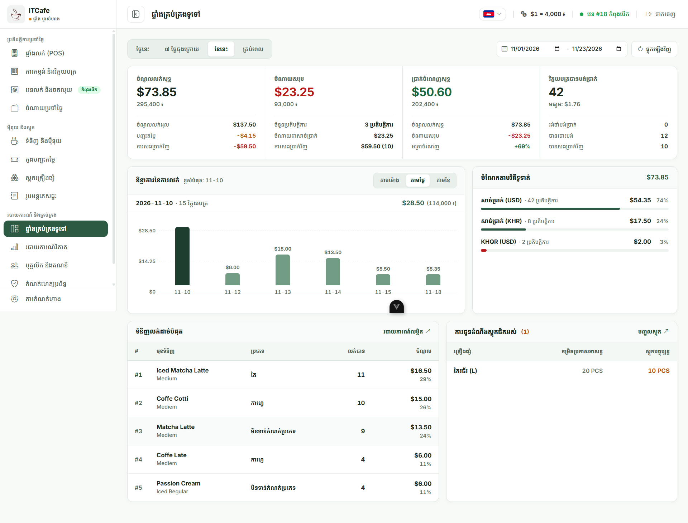

---

### 2. POS Terminal (`pagePos.png`)
Cashier checkout screen with category filtering, drink customization (size, sugar level, ice level, add-ons), promo code / discount application, hold orders, and dual-currency (USD/KHR) payment processing.

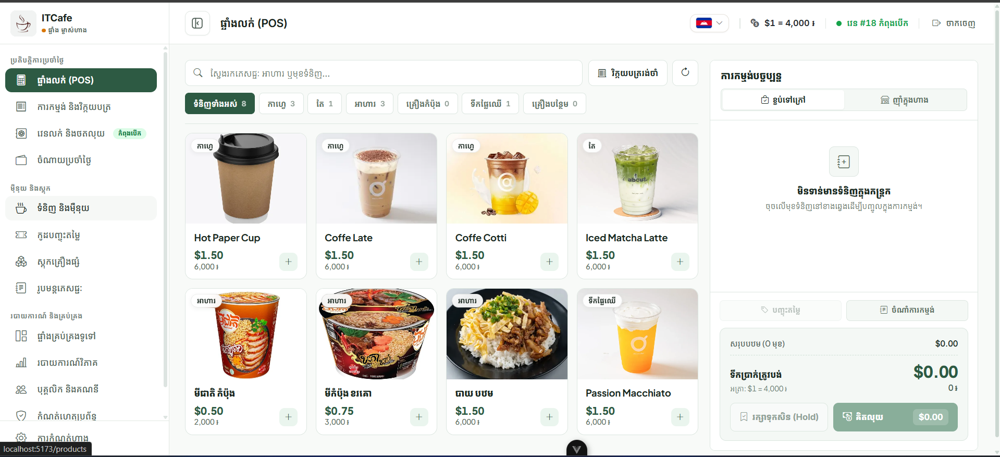

---

### 3. Staff Portal View — Role-Based Access (`pageOnlyStaff.png`)
Dedicated Staff/Cashier portal showing role-permitted navigation and operations in Khmer/English.

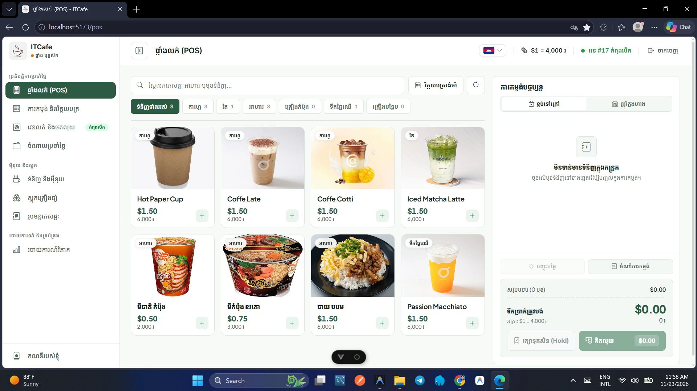

---

### 4. Orders & Receipts History (`pageOrdersReceipts.png`)
Complete transaction log for orders, completed payments, and refunds with live receipt preview and thermal receipt printing.

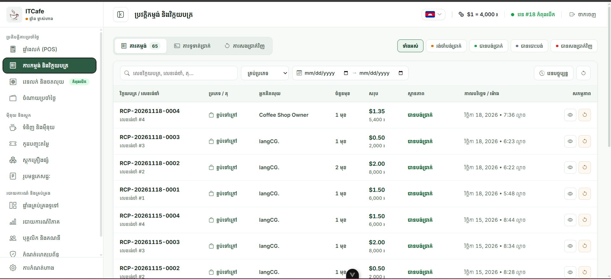

---

### 5. Shifts & Cash Drawer (`pageShifts.png`)
Cashier shift opening/closing workflow, real-time expected vs. counted cash reconciliation (USD & KHR), and shift history logs.

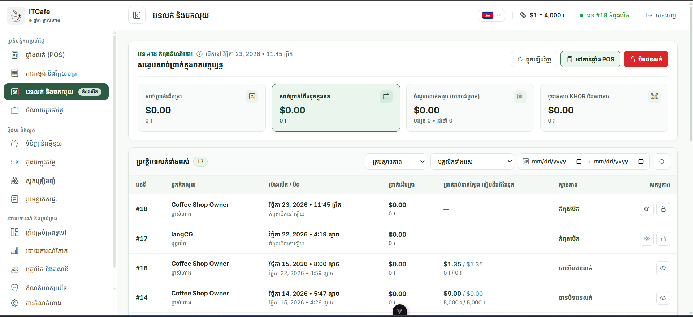

---

### 6. Daily Expenses (`pageDailyExpenses.png`)
Track daily shop expenses by category, payment method, and currency with shift cash drawer deduction and void tracking.

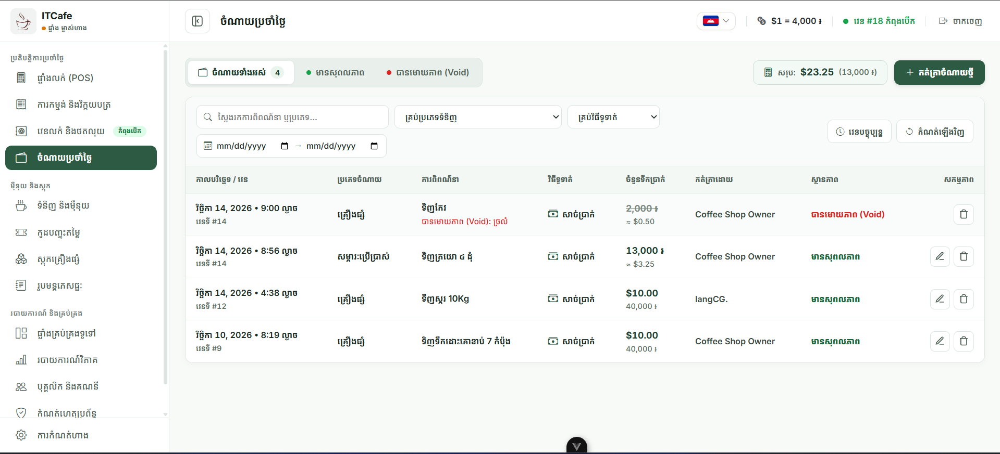

---

### 7. Products & Menu Catalog (`pageMenu.png`)
Manage drinks, food, add-ons, product categories, pricing variants, and product images.

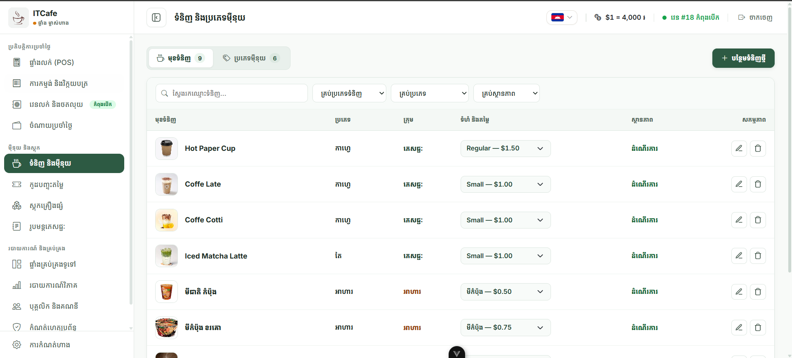

---

### 8. Discount Codes & Promotions (`paegePromocode.png`)
Create and manage promotional discount codes (percentage or fixed amount), usage limits, minimum order rules, and expiration dates.

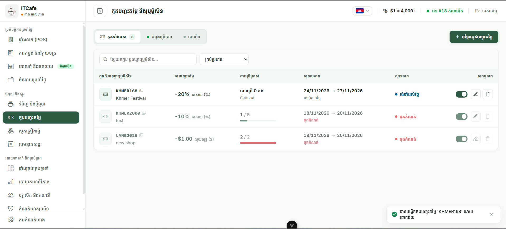

---

### 9. Inventory & Stock Movements (`pageInventoryStock.png`)
Track raw ingredients (grams, milliliters, pieces), stock health indicators, low-stock alerts, and stock movement ledgers (purchases, sales, waste, adjustments).


---

### 10. Drink Recipes / Bill of Materials (`pageDrinkRecipes.png`)
Configure ingredient quantities per product variant with automatic sugar-level scaling and estimated cup yield calculations.

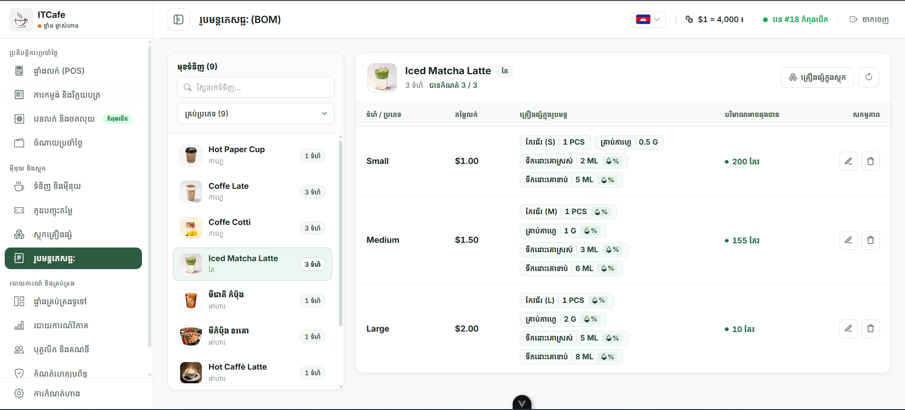

---

### 11. Reports & Analytics (`pageReports.png`)
Detailed analytical reports covering top-selling variants, ingredient consumption, category revenue share, payment methods breakdown, and staff performance.

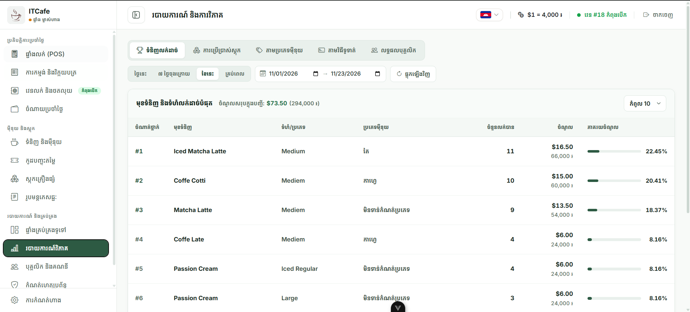

---

### 12. Staff & Users Management (`pageAccStaff&Users.png`)
Manage Owner and Staff accounts, role assignments, account activation status, and password resets.

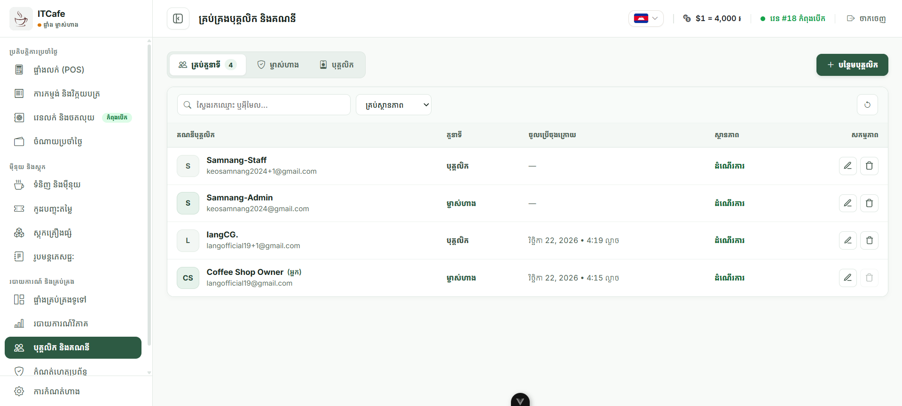

---

### 13. System Audit Logs (`pageAuditLogs.png`)
Security and activity audit trail tracking user actions across modules with timestamps, IP addresses, and JSON payload inspection.

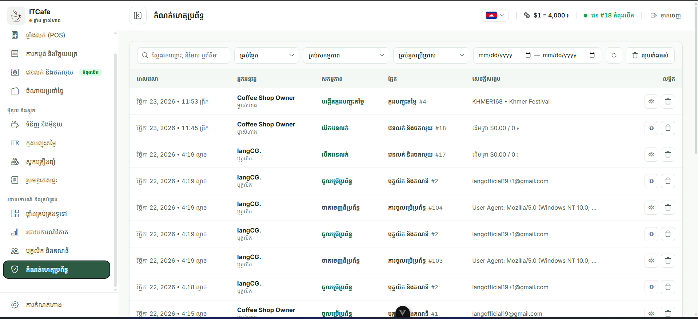

---

### 14. Shop Settings (`pageSetting.png`)
Configure shop profile, logo, USD to KHR exchange rate, tax rate, and thermal receipt layout settings.

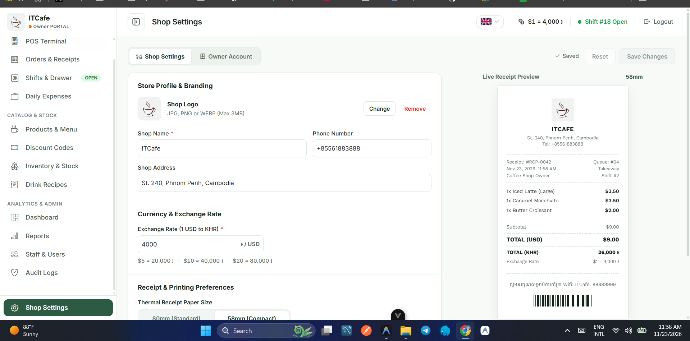

---

## 🚀 Project Setup

### 1. Install Dependencies

```sh
npm install
```

### 2. Configure Environment Variables

Copy `.env.example` to `.env` and update your MySQL database credentials, JWT secrets, and SMTP configuration:

```sh
cp .env.example .env
```

### 3. Import Database Schema

Import `src/database/db.sql` into your MySQL server.

### 4. Run the Server

```sh
# Development mode (auto-watch)
npm run dev

# Production mode
npm start
```

---

© Developed by **Songhai Yeanlang**. All rights reserved.
